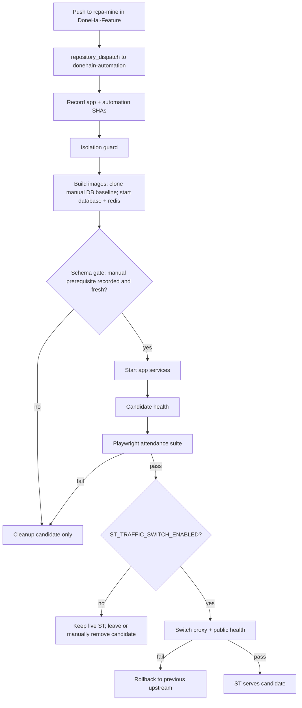

# ST candidate deployment and Playwright gating

This pipeline builds an **isolated** DoneHai-Feature candidate on the ST VPS, runs the **approved** Playwright suite from `donehain-automation` at a **recorded commit SHA**, and only switches public ST traffic when every gate passes **and** explicit validation flags are enabled.

Traffic switching is **off by default** until candidate isolation, database setup, side-effect suppression, and rollback have been verified on ST.

## Flow



## Triggers

1. **Recommended:** Add the companion workflow from `companion/DoneHai-Feature-rcpa-mine-trigger.yml.example` to the **DoneHai-Feature** repository on branch `rcpa-mine`. It sends `repository_dispatch` with the **exact** pushed commit SHA (never `main` or a floating ref).

2. **Manual:** `workflow_dispatch` on `ST candidate deploy (Playwright gate)` with `app_commit_sha` (40 characters).

## GitHub configuration (ST only)

Configure these on **donehain-automation** only. Do not reuse production/GCP credentials.

### Repository variables

| Variable | Purpose |
|----------|---------|
| `ST_CANDIDATE_DEPLOY_ENABLED` | Must be `true` or the workflow fails closed in `validate`. |
| `ST_TRAFFIC_SWITCH_ENABLED` | Must be `true` to run `switch-traffic` after Playwright passes. Leave unset/`false` until validation is complete. |
| `ST_ISOLATION_PROFILE_VALIDATED` | Must be `true` together with the above before any traffic switch. |

### Secrets (names only — do not commit values)

| Secret | Purpose |
|--------|---------|
| `ST_CANDIDATE_PROFILE_PATH` | Absolute path on the ST runner to `candidate.profile` (from `candidate.profile.example` + discovery). |
| `ST_TRAFFIC_SWITCH_SCRIPT_PATH` | Executable proxy switch/rollback script produced after Phase 0 discovery (not stored in this repo). |
| `ST_CANDIDATE_BASE_URL` | Optional. Playwright `BASE_URL` when not using deploy output (e.g. internal hostname). |
| `BASE_URL` | Used by standard Playwright CI against **public** ST; for candidate runs, prefer deploy output or `ST_CANDIDATE_BASE_URL`. |
| `TEST_IDENTIFIER` | Staging test account email/phone for fixed OTP. |
| `TEST_OTP` | Six-digit staging OTP. |
| `ST_APP_REPO_DISPATCH_TOKEN` | (App repo only) PAT or GitHub App token allowed to dispatch `st-candidate-deploy` on **donehain-automation** — **ST scope only**. |

### Runner

Jobs `deploy-candidate`, `playwright-gate`, and `promote-or-cleanup` require a **self-hosted** runner on the ST VPS with labels: `self-hosted`, `donehai-st`. The runner user must access Docker and the paths in `candidate.profile`. Playwright runs on the same runner so `http://127.0.0.1:<candidate-port>/` is reachable without exposing the candidate publicly.

## VPS profile and isolation

1. Run Phase 0 discovery: `deployment/st-ci/README.md`.
2. Copy `candidate.profile.example` to the VPS (e.g. `/etc/donehai-st/candidate.profile`) and fill in values from the discovery report.
3. Set `ST_CANDIDATE_PROFILE` / `ST_CANDIDATE_PROFILE_PATH` to that file.
4. `isolation-guard.sh` fails closed if:
   - Candidate compose project matches live project or does not match `donehai-candidate-*`.
   - Ports collide with live ST (8080, 3001, 3000, …).
   - Live DB/Redis/Kafka reuse flags are set.
   - Side-effect suppression flag is not `1`.
   - `ST_CANDIDATE_MIGRATIONS_ALLOWED` or `ST_CANDIDATE_DB_SEED_ONLY` is not `0`. Migrations are applied manually on ST and production, and the pipeline never runs migrations, seeds, schema dumps or `Local.sql`.
   - `ST_CANDIDATE_DB_BASELINE_VOLUME` is a protected live volume, belongs to the live compose project, or is a per-run candidate volume.
5. `deploy` also fails closed if the resolved candidate Compose config has external networks/volumes, `DATABASE_URL`, or `DB_HOST`/`PGHOST`/`REDIS_URL`/`KAFKA_BROKERS` pointing outside the candidate project.

## Database: manual migration prerequisite

The candidate never migrates a database. Each run's `db-data` volume is either:

- **cloned** (file copy, source mounted read-only, no SQL) from `ST_CANDIDATE_DB_BASELINE_VOLUME`, which an operator prepares manually with the app's documented migration order plus the QA fixtures, or
- **bootstrap-only** (extensions, `postgres` NOLOGIN role, `donehai_candidate` marker) when no baseline is set.

After `database` and `redis` are healthy, and before any app service starts, `deploy` runs the app's read-only `deployment/st-ci/check-candidate-schema.sql` inside the candidate DB container. It continues only if the result is `status=ok`, the recorded `migrated_from_sha` is an ancestor of the pinned app SHA, and no path in the app's `deployment/st-ci/candidate-schema-paths.txt` changed in between. Otherwise it stops with `not_candidate`, `not_migrated`, `missing_relations`, `missing_fixtures`, `stale` or `gate_error` and prints the operator action. Full procedure: app repo `deployment/st-ci/CANDIDATE_DATABASE.md` ("Manual prerequisite").

The gate checks the recorded prerequisite, freshness, the tables the E2E suite uses, and the QA fixtures. It does not validate the full application schema.

## Failure handling

| Stage | On failure |
|-------|------------|
| Validate / isolation / build / candidate health | No traffic change; candidate may not start. |
| Playwright | No traffic change; **cleanup-candidate** removes containers/volumes labeled with the candidate compose project only. |
| Traffic switch | **rollback-traffic** via `ST_TRAFFIC_SWITCH_SCRIPT`; public health re-checked. |

Live stack labels (`ST_LIVE_COMPOSE_PROJECT`, protected volumes) are never removed by cleanup.

## Rollback

- **Before switch:** Public ST unchanged; delete candidate with `candidate-lifecycle.sh cleanup-candidate` if needed.
- **After switch:** `candidate-lifecycle.sh rollback-traffic` (or the switch script’s `rollback` subcommand) restores the saved upstream. Previous containers/images should remain until manually pruned.

## Recorded SHAs

Each deploy writes a manifest under `ST_DEPLOY_STATE_DIR` (env or profile; default `${XDG_STATE_HOME:-$HOME/.local/state}/donehai-st/deployments`, owned by the runner user). The directory must persist across the three self-hosted jobs. If it cannot be created or written, the command fails with an error, and every manifest write is checked; a failed write is never reported as success. The manifest contains:

- `app_commit_sha` (from dispatch input)
- `automation_commit_sha` (from `actions/checkout` ref in `validate`)
- `candidate_id` (compose project name)

The workflow never checks out the app repo at `rcpa-mine` HEAD without an explicit SHA.

## App-side dependencies (complete before first deploy)

These are **not** in `donehain-automation` and must exist in **DoneHai-Feature** (or ST ops) first:

1. **`deployment/docker-compose.st-candidate.yml`** (`ST_APP_CANDIDATE_COMPOSE_FILE`) — standalone candidate stack: own Postgres/Redis, no `container_name`, project-scoped volumes/network, candidate ports, Kafka off, notifications no-op. `deploy` runs it with `-p donehai-candidate-<short_sha>-<run_id>` and `up --wait`; the live compose file is never used.
2. **Candidate DB bootstrap and schema gate**: `deployment/st-ci/initdb/90-candidate-db-init.sh` (infrastructure only), `deployment/st-ci/check-candidate-schema.sql` and `deployment/st-ci/candidate-schema-paths.txt` (see the app's `deployment/st-ci/CANDIDATE_DATABASE.md`). The manually prepared baseline must include the fixed-OTP accounts (`test1`…`test5@donehai.com`) from the app's `deployment/st-ci/candidate-seeds/10-fixed-otp-test-accounts.sql`, applied by the operator. The `playwright-gate` job checks `TEST_IDENTIFIER` (use `test1@donehai.com`) exists via `/api/otp-auth/check-user-access`, then runs `tests/attendance/` by default. `tests/tour` is not part of the gate: its fixture lists ST employees outside the seeded QA org and a fixed 01–09 Oct range that the page does not default to.
3. **Companion dispatch workflow** on `rcpa-mine` pushes (see `companion/`).
4. **`ST_TRAFFIC_SWITCH_SCRIPT`** on the VPS — implements `save-previous`, `apply-candidate`, and `rollback` for your nginx/Caddy/traefik setup from discovery.
5. **Auth/base URL** — if Playwright uses `http://127.0.0.1:<port>`, the app must accept that origin/cookies for login, or set `ST_CANDIDATE_BASE_URL` to an approved ST hostname that routes only to the candidate upstream.

## Local checks (no VPS)

```bash
bash deployment/st-ci/scripts/self-test.sh
npm run typecheck
```

Do not enable `ST_TRAFFIC_SWITCH_ENABLED` until isolation, DB setup, side-effect suppression, and rollback drills succeed on ST. Even when enabled, `switch-traffic` refuses unless the candidate's manifest records `db_init_status=ok` (schema gate passed) and `playwright_result=passed`. Without a switch, the candidate is always cleaned up at the end of the run.
